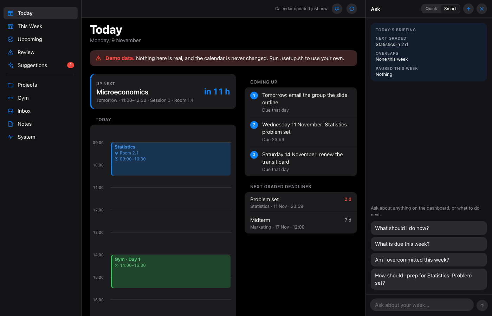
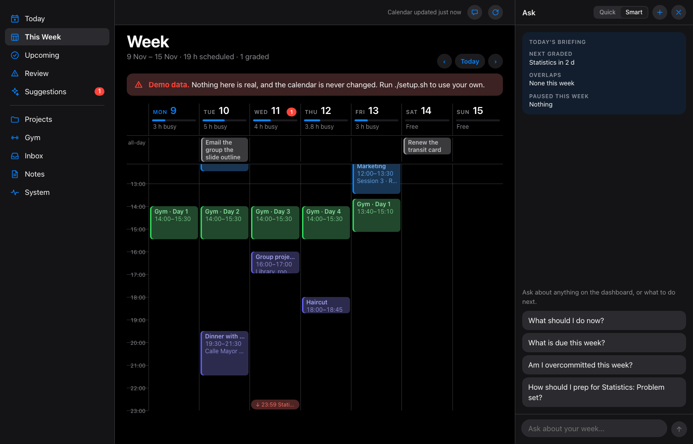
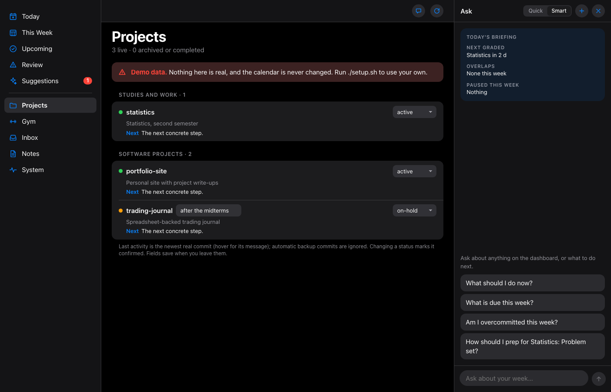

# personal-manager

A local planning system for macOS. It puts your calendar, deadlines, tasks and projects on one dashboard, turns
mail and phone notes into suggestions, and answers "what should I do now?" with your real week in view.
Your data stays in plain files on your Mac. A [Claude Code](https://claude.com/claude-code) session in this
folder works as the planner.



## Try it in ten seconds

```
git clone <this repo> personal-manager && cd personal-manager
python3 dashboard/server.py --demo        # then open http://127.0.0.1:8765
```

Demo mode shows a fictional student's week. It never reads your calendar or mail, never changes anything, and
the chat is off.

| | |
|---|---|
|  |  |

## Install

You need macOS and Python 3.11 or newer. The Claude Code CLI is optional and adds the chat, mail suggestions and
inbox processing; they run under **your own** Claude login.

```
./setup.sh
python3 dashboard/server.py
```

`setup.sh` does four things. It is safe to re-run.
- Creates your private files from `examples/`: `state.md`, `items.json`, `registry/` and `CLAUDE.md`.
- Asks a few questions and writes `config.env`.
- Installs the 15-minute calendar export.
- Checks for Claude Code.

Everything personal is gitignored.

## Connect your own tools

| tool | how | setting |
|---|---|---|
| Apple Calendar, plus every account it syncs (iCloud, Exchange, Google) | EventKit, read-only | `PM_CALENDAR_SOURCES=eventkit` |
| Google Calendar, Outlook / Office 365, school timetables | secret iCal links in `ics_feeds.txt`, read-only, no Apple permission needed | `PM_CALENDAR_SOURCES=ics` (or `eventkit,ics`) |
| Writing events | only to one calendar you name, create-only, with a duplicate check | `PM_WRITE_CALENDAR` |
| Feeds that must never be touched | hidden duplicates, never edited or deleted | `PM_READONLY_CALENDARS` |
| Mail.app accounts | headers only. A model picks the mails that look like events, then reads only those | `MAIL_ACCOUNTS` |
| Reminders list "Manager Inbox", folder `inbox/` | phone captures, filed automatically | `scripts/install_inbox.sh` |
| Obsidian vault | chat memory, project notes, gym plan | `VAULT_DIR` |
| iPhone / Siri | ask the dashboard by voice through a private Tailscale link | `scripts/install_phone.sh` |
| Anything else | a plugin: one Python file adds a confirmable chat action and phone routes | [`plugins/README.md`](plugins/README.md) |

Optional modules stay silent until you set them up: the gym tracker (`app/gym`, `scripts/install_gym.sh`),
BB Tracker (Blackboard deadlines, `BB_TRACKER_DATA`) and the daily vault sync (`scripts/install_vault.sh`).

## Configuration

`config.env` holds `KEY=value` lines; environment variables win. [`scripts/pm_env.py`](scripts/pm_env.py) lists every
setting with its default. The ones you are most likely to change:

| setting | meaning | default |
|---|---|---|
| `PM_OWNER_NAME` | your first name: tasks are filed for it, and a flight whose title starts with it is yours | (empty) |
| `PM_TIMEZONE` | IANA timezone | `UTC` |
| `PM_CALENDAR_SOURCES` | `eventkit`, `ics`, or `eventkit,ics` | `eventkit` |
| `PM_WRITE_CALENDAR` | the one calendar the tools may create events in | `Private` |
| `PM_READONLY_CALENDARS` | feeds that are never touched (comma separated) | (empty) |
| `MAIL_ACCOUNTS` | Mail.app account names for suggestions | `iCloud` |
| `VAULT_DIR` | Obsidian vault | `~/Documents/Vault` |
| `PM_CLASS_CALENDARS`, `PM_CLASS_TITLE`, `PM_CLASS_SKIP` | classes, for planning the gym after the last class | (empty) |
| `PM_CHAT_RULES` | your own rules for the chat (travel mode, preferences) | `config/chat_rules.md` |
| `PM_NEVER_ADD` | regex for events that must never be added, and are hidden | (empty) |
| `PM_LABEL_PREFIX` | LaunchAgent label prefix | `com.personal-manager` |

## Safety model

- **The model only proposes.** Every change appears as a button: add an event, add a task, delete one event in
  your writable calendar, run a plugin action. Nothing happens until you click it. On the phone, a plain "yes" is
  checked by code, not by a model. Mail and web pages reach the model as data, never as instructions.
- **Create-only calendar.** Events go only into `PM_WRITE_CALENDAR`, and a same-title, same-day duplicate is refused.
  A delete happens only on your click, and the original is logged to `data/calendar_deletes.jsonl`.
- **Local-only dashboard** on 127.0.0.1, with a Host check against DNS rebinding and an Origin check on writes.
  See [SECURITY.md](SECURITY.md).

## Privacy

The scripts read your calendar, reminders and mail on your Mac. Only two things leave it. Features that call the
`claude` CLI send their input to Anthropic under your own Claude account and its data settings. The optional gym
sync goes to your own Netlify site.

| feature | what the model receives |
|---|---|
| Dashboard chat | the snapshot: calendar, deadlines, `state.md`, `CLAUDE.md`, matching vault notes, plus the conversation. It can search the web and read pages in your signed-in Chrome. It is told never to confirm, pay or type into forms, and it gets no form-fill or script tools, but it can click |
| Mail suggestions (`scripts/mail_suggest.py`) | sender and subject of recent mail, then the full text of the mails it picks |
| Inbox (`scripts/inbox_process.py`) | the text of open "Manager Inbox" reminders and files in `inbox/`. The session runs in this folder and can read its files |
| Gym review (`scripts/gym_review.py`) | your logged workouts |

These make no model calls: the calendar export, ICS feeds, registry, dashboard pages and vault sync. Before you
run the prompts in `scripts/` and `dashboard/server.py` against your accounts, read them, and read
`scripts/mail_filter.json`.

## Background jobs

Each job is an optional LaunchAgent with its own `scripts/install_*.sh` (`--remove` uninstalls it).
`python3 scripts/health.py` and the dashboard's System page show their state.

| job | every | script |
|---|---|---|
| calendar export | 15 min | `scripts/export_calendar.py` |
| mail suggestions | hour | `scripts/mail_suggest.py` |
| inbox processing | 5 min | `scripts/inbox_process.py` |
| `state.md` auto block | hour | `scripts/state_refresh.py` |
| dashboard, phone endpoint | always on | `dashboard/server.py`, `scripts/phone_server.py` |
| gym sync, vault sync | 15 min, daily | `scripts/gym_ingest.py`, `scripts/vault_daily.py` |

## Layout

```
dashboard/   local web dashboard (server.py + index.html)
scripts/     calendar export (EventKit + ICS), inbox and mail intake, health, gym, vault sync, settings (pm_env.py)
plugins/     your own chat actions and phone routes (README + example)
app/         gym PWA (app/gym) and its Netlify functions (app/gym-functions)
examples/    starter state.md, items.json and a registry entry
tests/       python3 -m unittest discover -s tests   (standard library; no network, no model)
```

## Contributing

Issues and pull requests are welcome. See [CONTRIBUTING.md](CONTRIBUTING.md). Report security problems privately
(see [SECURITY.md](SECURITY.md)).

## License

MIT, see [LICENSE](LICENSE).
